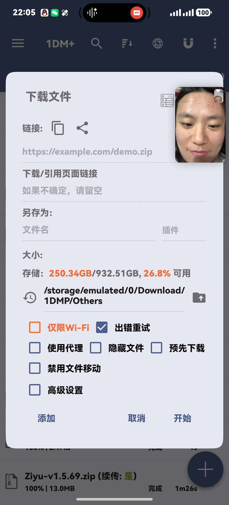
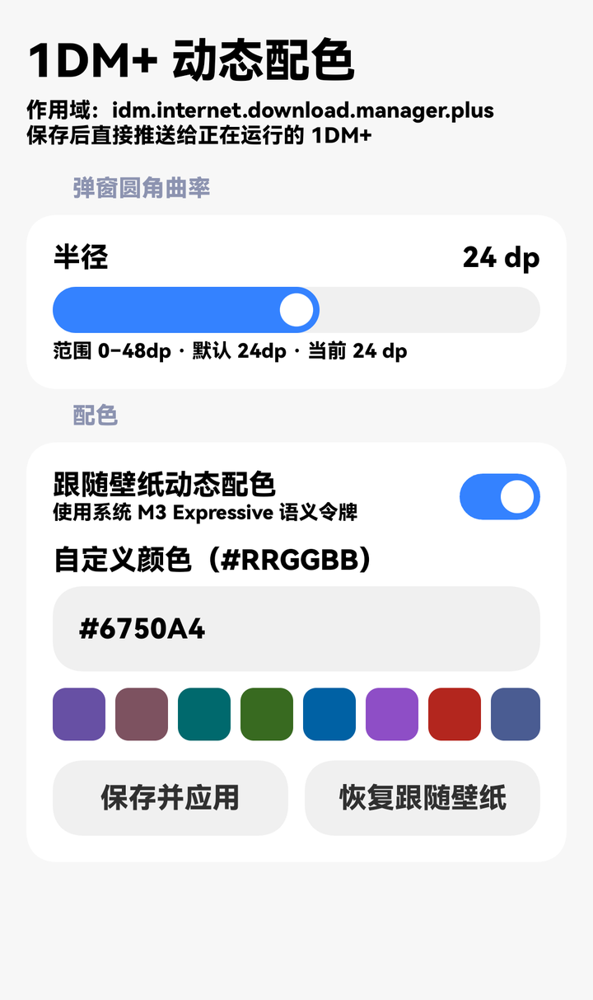

# 1DM+ M3 Expressive Theme

[简体中文](README.md) | **English**

Material 3 Expressive dynamic colors and G2 continuous-curvature (squircle) dialogs for **1DM+**
(`idm.internet.download.manager.plus`), with a native **Miuix** settings UI.
Everything is implemented inside a single LSPosed module — no RRO overlay, no Magisk/KSU module.

## Scope

- `idm.internet.download.manager.plus` only (`staticScope=true`)

## Screenshots

| Themed toolbar (wallpaper colors) | Squircle download dialog |
|---|---|
|  |  |

Settings screen, built with [Miuix](https://github.com/compose-miuix-ui/miuix) (Compose Multiplatform):

## Features

### Dynamic color from the wallpaper

- Colors come from the system Material 3 **semantic** tokens, not the old tonal palette:
  `system_primary_light/dark`, `system_on_primary_*`, `system_secondary_*`, `system_tertiary_*`,
  `system_primary_container_*`, `system_surface_*`, `system_surface_container_low/high_*`,
  `system_on_surface_*`, `system_outline_variant_*`, `system_error_*`.
- Resolved as compile-time constants, selected by `uiMode`, updated automatically when the wallpaper changes.
- Full mapping of 1DM+'s own resource IDs (from its `public.xml`) plus a name/brand-value fallback,
  so no original teal (`#80cbc4`) survives. Toolbar, tab bar and indicator, FAB, checkboxes,
  progress bars, drawer, list background, dividers, links and highlighted text are all mapped.

### Custom accent color

- Pick any `#RRGGBB` in the settings screen. It is applied to accents and the toolbar; the toolbar
  color is darkened until white text reaches a contrast ratio of at least 4.5:1.
- One tap restores wallpaper-following mode.
- The config is delivered to the target process over a directed broadcast and cached inside it,
  so a change takes effect the next time a screen or dialog is opened — no reboot, no process restart.

### Squircle dialogs (G2 continuous curvature)

- Dialog corners follow the superellipse `(|dx|/R)^4 + (|dy|/R)^4 = 1`, drawn with anti-aliasing —
  not a circular arc.
- The dialog card background is `system_surface_container_high` (`_dark` in dark mode), never plain white.
- Hook sequence: `Dialog#show` before → window background + 16dp inset; after → `decor.post()` →
  walk the view tree (depth ≤ 14) and replace the outer solid-background card.

### Adjustable corner curvature

- A single slider controls the corner radius: **0–48 dp, default 24 dp**, step 1 dp.
  The curve family stays G2 (n = 4).
- Measured on a 1080×2376 @480dpi device (inset from the bottom edge at dy = 6/12/24 px):

  | radius | measured | superellipse theory |
  |---|---|---|
  | 8dp (24px) | 2 / 1 / 0 | 2.2 / 0.4 / 0 |
  | 24dp (72px) | 19 / 11 / 4 | 19.0 / 10.9 / 3.9 |
  | 40dp (120px) | 41 / 28 / 15 | 41.0 / 28.0 / 15.0 |

## Requirements

- Android 9+ (API 28 or newer recommended), LSPosed with **LibXposed API 102**
- Module packaging follows API 102: `META-INF/xposed/module.prop`
  (`minApiVersion=102`, `targetApiVersion=102`, `staticScope=true`), `java_init.list`, `scope.list`

## Usage

1. Install the APK.
2. Enable the module in LSPosed; the scope is fixed to 1DM+.
3. Force stop 1DM+ and open it again.
4. To customize, open **1DM+ M3 Expressive Theme** from the launcher: pick a color and/or drag the
   corner-radius slider, then tap **Save and apply**.

## How it is built

The settings UI is [Compose Multiplatform](https://github.com/JetBrains/compose-multiplatform) with
Miuix components; the hook code stays plain Java. See [BUILDING.en.md](BUILDING.en.md) for the exact toolchain
and the workarounds needed to build a Compose app on an arm64-only machine.

## Notes

- Every hook installs independently and runs in `ExceptionMode.PROTECTIVE`: a failing hook is logged
  and skipped, and the original value is returned, so the target app never crashes because of the module.
- Disabling the module and restarting 1DM+ restores the original look completely — no APK or system
  files are modified.
