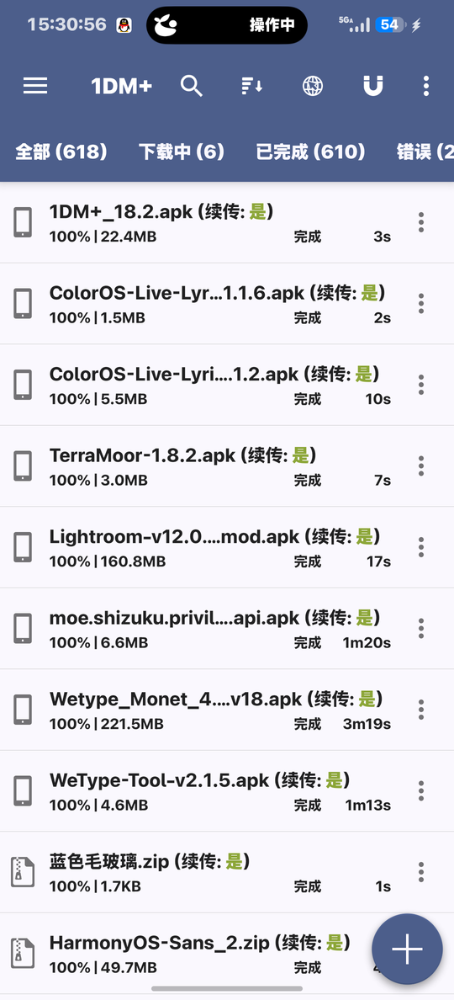
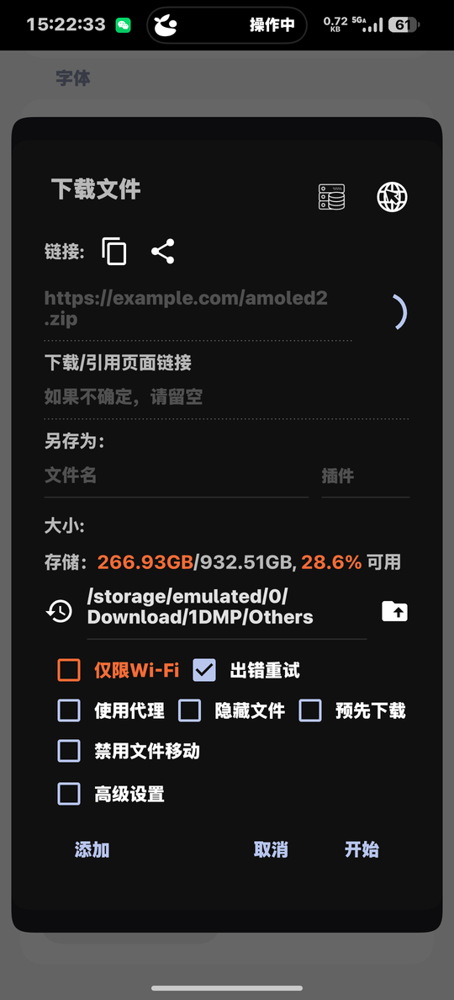
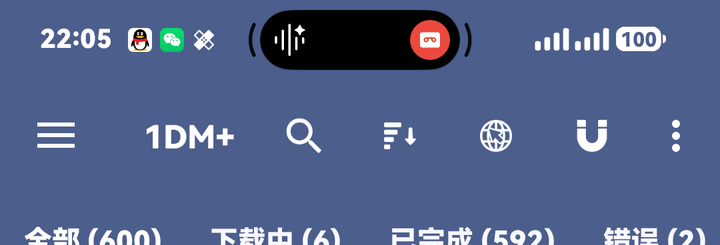

# 1DM+ Dynamic Colors (M3 Expressive theme)

[简体中文](README.md) | **English**

An **LSPosed module** that gives **1DM+** (`idm.internet.download.manager.plus`, a download manager)
**Material 3 Expressive / Material You dynamic color**: wallpaper-based (Monet) colors, G2 continuous-curvature
(squircle) dialogs, adjustable corner radius *and* curvature exponent, dark mode and AMOLED black.
The settings screen is built with native **Miuix** components.

Everything lives in a single LSPosed module — no RRO overlay, no patched APK, no Magisk/KernelSU module.
Disable the module and restart the app to get the original look back.

> Keywords: 1DM+ · IDM · download manager · dynamic color · Monet · Material You · M3 Expressive ·
> dark mode · rounded corners · continuous curvature · squircle · AMOLED · LSPosed · LibXposed API 102

## Scope

- `idm.internet.download.manager.plus` only (`staticScope=true`)

## Screenshots

| Light · dynamic list | Dark · AMOLED dialog |
|---|---|
|  |  |

| Themed toolbar (wallpaper colors) | Squircle download dialog |
|---|---|
|  |  |

Settings screen, built with [Miuix](https://github.com/compose-miuix-ui/miuix) (Compose Multiplatform):

## Downloads

| File | What it is |
|---|---|
| **[1dm-theme-1.2.apk](https://github.com/Xposed-Modules-Repo/io.github.freesol916.idmtheme/releases/latest)** | The module itself (LSPosed) |

**1DM+ (the target app)** is distributed by its author only — get it from an official channel:

- Google Play: <https://play.google.com/store/apps/details?id=idm.internet.download.manager.plus>
- Official site: <https://www.internetdownloadmanager.com/>

- Verified against **1DM+ 18.2 (versionCode 30249)**. If some colors do not follow after an app update,
  open the module settings and tap **Save and apply** once to re-push the config.
- After installing the module **force stop 1DM+ and open it again** — hooks load at process start.

## Features

### Dynamic color from the wallpaper

- Colors come from the system Material 3 **semantic** tokens, not the old tonal palette:
  `system_primary_light/dark`, `system_on_primary_*`, `system_secondary_*`, `system_tertiary_*`,
  `system_primary_container_*`, `system_surface_*`, `system_surface_container_low/high_*`,
  `system_on_surface_*`, `system_outline_variant_*`, `system_error_*`.
- Resolved as compile-time constants, selected by `uiMode`, updated automatically when the wallpaper changes.
- Full mapping of 1DM+'s own resource IDs (from its `public.xml`) plus a name/brand-value fallback,
  so no original teal (`#80cbc4`) survives. Toolbar, tab bar and indicator, FAB, checkboxes,
  progress bars, drawer, list background, dividers, links and highlighted text are all mapped.

### Custom accent color

- Pick any `#RRGGBB` in the settings screen. It is applied to accents and the toolbar; the toolbar
  color is darkened until white text reaches a contrast ratio of at least 4.5:1.
- One tap restores wallpaper-following mode.
- The config is delivered to the target process over a directed broadcast and cached inside it,
  so a change takes effect the next time a screen or dialog is opened — no reboot, no process restart.

### Squircle dialogs (G2 continuous curvature)

- Dialog corners follow the superellipse `(|dx|/R)^4 + (|dy|/R)^4 = 1`, drawn with anti-aliasing —
  not a circular arc.
- The dialog card background is `system_surface_container_high` (`_dark` in dark mode), never plain white.
- Hook sequence: `Dialog#show` before → window background + 16dp inset; after → `decor.post()` →
  walk the view tree (depth ≤ 14) and replace the outer solid-background card.

### Adjustable curvature (radius + exponent)

- Two sliders: **radius 0–48 dp (default 24 dp)** and **exponent n = 2.0–8.0 (default 4.0)**.
  n = 4 is the G2 superellipse `(|dx|/R)^4 + (|dy|/R)^4 = 1`; n = 2 degenerates into a circular arc;
  larger n tends to a square corner.
- Measured on a 1080×2376 @480dpi device (inset from the bottom edge at dy = 6/12/24 px, radius 24dp = 72px):

  | exponent n | measured | superellipse theory |
  |---|---|---|
  | 2 (arc) | 40 / 29 / 16 | 43.2 / 32.2 / 18.3 |
  | 4 (G2) | 19 / 11 / 4 | 19.0 / 10.9 / 3.9 |
  | 8 | 6 / 3 / 1 | 6.0 / 2.3 / 0.4 |

  Measured values run 0–3px below theory: the anti-aliased edge is detected against the exact card color.

### Dark mode and AMOLED

- Follows the system light/dark setting; semantic tokens switch to the `_dark` set automatically.
- Optional **AMOLED black** switch: in dark mode `surface` / `surface_low` are forced to `#000000`
  and `surface_high` (cards, dialogs) to `#101010` — a true-black list that still keeps card layering.

### Older Android versions

- The semantic tokens (`system_primary_light` and friends) only exist on Android 14+.
- **API 31–33**: falls back to the `system_accent1_*` / `system_neutral1|2_*` tonal tokens and
  synthesizes every role the way Material 3 does.
- **API 29–30**: no tonal tokens either, so the Material baseline palette is used instead —
  plain purple/grey rather than the original teal.

### Resource-drift resistance

- Role detection is **name-first**; the resource-ID table is only a fallback. When the two disagree
  the name wins and a `resource drift on 0x…` line is logged, so a 1DM+ update that shifts IDs does
  not silently break the whole mapping.

## Requirements

- Android 10+ (minSdk 29), LSPosed with **LibXposed API 102**
- Module packaging follows API 102: `META-INF/xposed/module.prop`
  (`minApiVersion=102`, `targetApiVersion=102`, `staticScope=true`), `java_init.list`, `scope.list`

## Usage

1. Install the APK.
2. Enable the module in LSPosed; the scope is fixed to 1DM+.
3. Force stop 1DM+ and open it again.
4. To customize, open **1DM+ M3 Expressive Theme** from the launcher: pick a color, drag the radius
   and curvature sliders, toggle AMOLED if wanted, then tap **Save and apply**.

## How it is built

The settings UI is [Compose Multiplatform](https://github.com/JetBrains/compose-multiplatform) with
Miuix components; the hook code stays plain Java. See [BUILDING.en.md](BUILDING.en.md) for the exact toolchain
and the workarounds needed to build a Compose app on an arm64-only machine.

## Notes

- Every hook installs independently and runs in `ExceptionMode.PROTECTIVE`: a failing hook is logged
  and skipped, and the original value is returned, so the target app never crashes because of the module.
- Disabling the module and restarting 1DM+ restores the original look completely — no APK or system
  files are modified.
