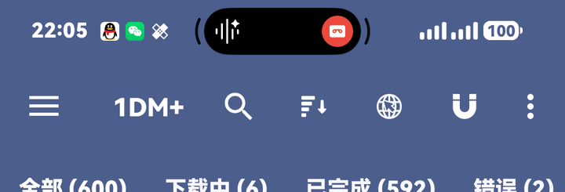
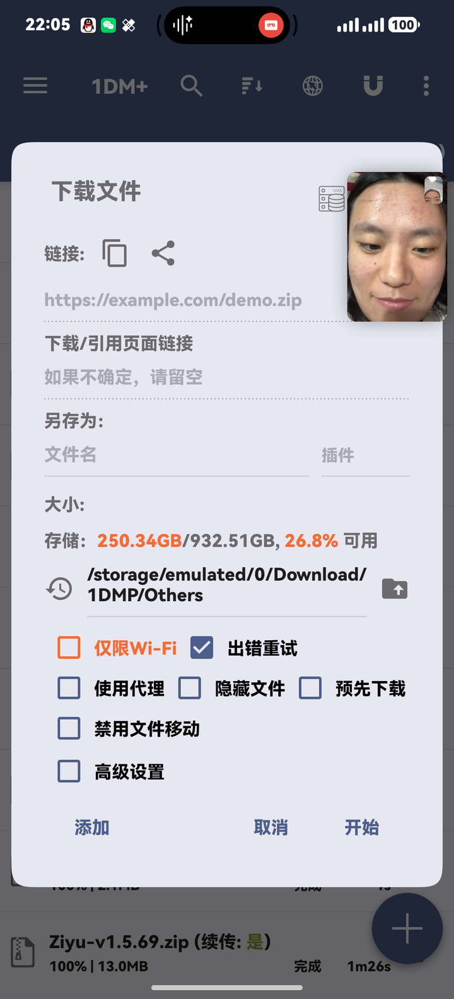
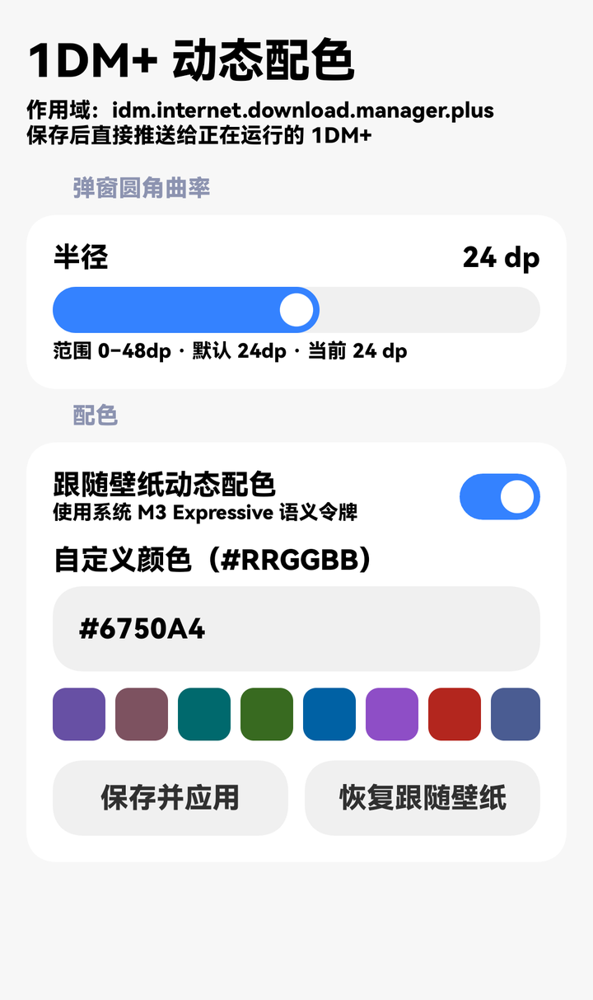

# 1DM+ 动态配色（M3 Expressive 主题）

**简体中文** | [English](README.en.md)

给 **1DM+**（`idm.internet.download.manager.plus`，IDM 下载管理器）做 **Material 3 Expressive / Material You 动态配色**
的 **LSPosed 模块**：颜色跟随壁纸（莫奈取色），弹窗换成 G2 连续曲率（squircle）圆角，
圆角半径与曲率指数都能调，支持深色模式与 AMOLED 纯黑。设置界面用原生 **Miuix** 组件。

全部功能由单个 LSPosed 模块实现 —— 不用 RRO overlay，不用改 APK，也不用 Magisk / KernelSU 模块，
停用模块并重启应用即可完全恢复原样。

> 关键词：1DM+ · IDM · 下载管理器 · 动态配色 · 莫奈取色 · Material You · M3 Expressive ·
> 深色模式 · 圆角 · 连续曲率 · squircle · AMOLED · LSPosed · LibXposed API 102

## 作用域

- 仅 `idm.internet.download.manager.plus`（`staticScope=true`）

## 截图

| 动态配色工具栏（跟随壁纸） | G2 连续曲率下载弹窗 |
|---|---|
|  |  |

设置界面，使用 [Miuix](https://github.com/compose-miuix-ui/miuix)（Compose Multiplatform）构建：

## 功能

### 跟随壁纸的动态配色

- 颜色取自系统 Material 3 **语义令牌**，不使用旧的 tonal 调色板：
  `system_primary_light/dark`、`system_on_primary_*`、`system_secondary_*`、`system_tertiary_*`、
  `system_primary_container_*`、`system_surface_*`、`system_surface_container_low/high_*`、
  `system_on_surface_*`、`system_outline_variant_*`、`system_error_*`。
- 以编译期常量解析，按 `uiMode` 选择 `_light` / `_dark`；换壁纸后自动更新。
- 完整映射了 1DM+ 自身的资源 ID（来自它的 `public.xml`），另有「资源名 / 品牌色值」兜底，
  所以原版青绿色 `#80cbc4` 不会残留：工具栏、Tab 条与指示条、FAB、复选框、进度条、
  侧边栏、列表底色、分割线、链接文字色、高亮文字底色全部纳入映射。

### 自定义强调色

- 在设置里填任意 `#RRGGBB`，会应用到强调色和工具栏；工具栏颜色会自动压暗，
  直到上面的白字对比度不低于 4.5:1。
- 一键「恢复跟随壁纸」。
- 配置通过定向广播推送进目标进程并缓存在它自己的 cache 里，所以改色后**重新打开界面或弹窗**
  就生效，不需要重启手机、也不需要重启应用进程。

### G2 连续曲率弹窗

- 弹窗四角满足超椭圆方程 `(|dx|/R)^4 + (|dy|/R)^4 = 1`，带抗锯齿 —— 不是圆弧。
- 弹窗卡片底色取 `system_surface_container_high`（深色模式取对应的 `_dark`），不会是纯白。
- hook 时序：`Dialog#show` 调用前改 window background 并设 16dp inset；调用后 `decor.post()`
  再遍历视图树（深度上限 14 层），把最外层的实色背景视图换成自绘圆角。

### 可调圆角曲率（半径 + 指数）

- 两根滑块：**半径 0–48 dp（默认 24 dp）**、**指数 n = 2.0–8.0（默认 4.0）**。
  n = 4 就是 G2 超椭圆 `(|dx|/R)^4 + (|dy|/R)^4 = 1`；n = 2 退化成普通圆弧；n 越大越接近方形。
- 在 1080×2376 @480dpi 设备上实测（距底边 dy = 6/12/24 px 处左边界内缩量，半径 24dp = 72px）：

  | 指数 n | 实测 | 超椭圆理论值 |
  |---|---|---|
  | 2（圆弧） | 40 / 29 / 16 | 43.2 / 32.2 / 18.3 |
  | 4（G2） | 19 / 11 / 4 | 19.0 / 10.9 / 3.9 |
  | 8 | 6 / 3 / 1 | 6.0 / 2.3 / 0.4 |

  实测值普遍比理论小 0–3px，是抗锯齿边缘按「纯卡片色」判定的取整误差。

### 深色模式与 AMOLED

- 跟随系统深浅色，语义令牌自动切到 `_dark` 一组。
- 额外的 **AMOLED 纯黑** 开关：深色模式下把 `surface` / `surface_low` 压到 `#000000`、
  `surface_high`（卡片、弹窗）压到 `#101010`，主界面纯黑省电，卡片仍能分辨层次。

### 兼容旧系统

- 语义令牌（`system_primary_light` 这批）是 Android 14 才有的。
- **API 31–33**：自动改用 `system_accent1_*` / `system_neutral1|2_*` 的 tonal 令牌，按 M3 规则合成各角色配色。
- **API 29–30**：连 tonal 令牌都没有，退回 Material 基线配色（紫/灰一族），至少不会退化成原版青绿。

### 抗资源漂移

- 映射优先按**资源名**判断角色，资源 ID 表只作兜底；两者冲突时以名字为准并打一条
  `resource drift on 0x…` 日志。1DM+ 升级后 ID 变了，也不会整套失效。

## 环境要求

- Android 10+（minSdk 29），LSPosed 需支持 **LibXposed API 102**
- 模块按 API 102 格式打包：`META-INF/xposed/module.prop`
  （`minApiVersion=102`、`targetApiVersion=102`、`staticScope=true`）、`java_init.list`、`scope.list`

## 使用方法

1. 安装 APK。
2. 在 LSPosed 里启用模块（作用域已固定为 1DM+）。
3. 强制停止 1DM+ 再打开。
4. 想自定义就打开桌面上的 **1DM+ M3 Expressive Theme**：选颜色、拖半径与曲率滑块、
   按需打开 AMOLED，然后点 **保存并应用**。

## 构建方式

设置界面用 Compose Multiplatform + Miuix，hook 部分仍是纯 Java。
具体工具链版本和「在 arm64 机器上编 Compose」的几个绕行方案都写在
[BUILDING.md](BUILDING.md) 里。

## 说明

- 每一条 hook 都独立安装，并以 `ExceptionMode.PROTECTIVE` 运行：hook 内部抛异常只会记录日志
  并按「没有 hook」继续，不会让目标应用崩溃。
- 停用模块并重启 1DM+ 即可完全恢复原样 —— 模块不修改 APK，也不修改系统文件。
